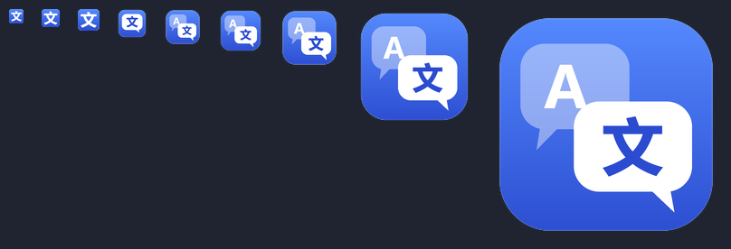

<h1 align="center">Select Translate</h1>

Bôi đen chữ ở bất kỳ app nào trên Windows để dịch <b>Việt · English · 中文</b> bằng <b>Claude</b> hoặc <b>ChatGPT (Codex)</b>. 
Dùng luôn tài khoản Claude/ChatGPT đã đăng nhập trên máy, không cần API key.

<a href="https://github.com/tawfung/select-translate/releases/latest/download/select-translate-x64.msi"><b>⬇ Tải bộ cài (.msi)</b></a>
&nbsp;·&nbsp;
<a href="https://github.com/tawfung/select-translate/releases/latest/download/select-translate-portable.zip">Bản portable (.zip)</a>
&nbsp;·&nbsp;
<a href="https://github.com/tawfung/select-translate/releases">Tất cả phiên bản</a>

## Siêu nhẹ, siêu nhanh, tiết kiệm token

- **Nhẹ**: một file exe khoảng 650 KB, viết bằng Rust và Win32 thuần. Không cần Python, .NET hay trình duyệt nhúng. Riêng tool chỉ chiếm khoảng 2–3 MB RAM.
- **Nhanh**: Claude/Codex luôn chạy nền và dùng chung một phiên, không phải khởi động lại mỗi lần bôi đen. Bản dịch bắt đầu hiện sau khoảng 1–3 giây, chữ chạy dần như khi chat.
- **Tiết kiệm token** nhờ cache ở hai tầng:
  - Đoạn đã dịch rồi được nhớ lại, bôi đen lại là hiện ngay, không gọi model, không tốn token.
  - Phần hướng dẫn dịch giống nhau ở mọi lần nên được Claude/Codex cache lại; mỗi lần dịch chỉ tính thêm phần chữ mới.
- **Gọn**: tool chạy CLI ở chế độ tối giản (không tool, không plugin, không lưu lịch sử), nên prompt ngắn, trả lời nhanh, và không đụng tới cấu hình CLI của bạn.

## Tính năng

- **Bôi đen là dịch**: popup hiện ngay cạnh chữ, mặc định dịch sang tiếng Việt.
- **Dịch ảnh như Snipping Tool**: chuột phải vào pet (hoặc `Ctrl+Alt+S`) rồi kéo khung quanh chỗ cần dịch: ảnh chụp màn hình, game, video, file PDF scan… AI đọc chữ trong khung và dịch luôn.
- **Viết lại EN / 中文**: bấm EN hoặc 中文 để viết lại cho đúng ngữ cảnh. Nếu chữ đã là ngôn ngữ đó, tool chỉ sửa chính tả và câu chữ.
- **Trả lời nhanh**: bấm **↩ Trả lời** dưới bản dịch, gõ câu trả lời bằng tiếng Việt hoặc English rồi Enter, AI viết lại sang EN hoặc 中文 (tự chọn theo ngôn ngữ tin nhắn gốc) ở khung bên cạnh, bấm icon copy là dán được vào chat. Popup trả lời chỉ đóng khi bấm ✕, click ra ngoài không mất bản nháp.
- **Dán thay**: thay đoạn đang bôi đen bằng bản dịch, rất tiện khi soạn tin nhắn.
- **Chọn model tuỳ ý**: đổi giữa Claude và Codex, model và mức effort ngay trên popup; danh sách model lấy theo tài khoản của bạn.
- **Pet nhỏ ở góc màn hình**: click để bật dịch, click lần nữa để tắt; kéo đi đâu cũng được.
- **Bôi đen bằng chuột hay bàn phím đều nhận**: kéo, double/triple-click, Shift+click, Shift + phím mũi tên, Ctrl+A.
- **Không làm phiền**: popup không lấy focus của ô chat, clipboard được trả lại như cũ.

## Cài đặt

1. Cài ít nhất một CLI rồi đăng nhập. Cần [Node.js](https://nodejs.org) để cài qua npm.

   | CLI | Gói tài khoản | Cài | Đăng nhập |
   |---|---|---|---|
   | Claude Code | Claude Pro/Max | `npm i -g @anthropic-ai/claude-code` | `claude auth login` |
   | Codex | ChatGPT Plus/Pro | `npm i -g @openai/codex` | `codex login` |

2. Tải [**select-translate-x64.msi**](https://github.com/tawfung/select-translate/releases/latest/download/select-translate-x64.msi), double-click là xong.
   - Không cần quyền admin. Có shortcut trong Start Menu, tool tự chạy cùng Windows.
   - Nếu SmartScreen cảnh báo, bấm **More info → Run anyway**.

Muốn dùng không cần cài: tải [bản portable](https://github.com/tawfung/select-translate/releases/latest/download/select-translate-portable.zip), giải nén rồi chạy `select-translate.exe`.

Gỡ cài đặt: *Settings → Apps → Select Translate → Uninstall*.

## Sử dụng

| Pet | Khi bôi đen |
|---|---|
| Tắt | Dịch ngay trong iMe (đổi danh sách app trong `config.json`) |
| Bật, màu xám | Không dịch |
| Bật, màu xanh ngọc (đã click) | Dịch ở mọi app, cho đến khi click pet lần nữa |

| Phím tắt | Tác dụng |
|---|---|
| `Ctrl+Alt+S` | Dịch ảnh: kéo chọn vùng màn hình (Esc để huỷ) |
| `Ctrl+Alt+P` | Bật/tắt pet |
| `Ctrl+Alt+T` | Tạm dừng |
| `Ctrl+Alt+Q` | Thoát |

Popup dịch tự đóng khi click ra ngoài; popup trả lời (Enter = viết, Shift+Enter = xuống dòng) chỉ đóng bằng ✕.

Click pet để bật/tắt dịch bôi đen, chuột phải vào pet để dịch ảnh. Click icon ở khay hệ thống để mở menu: chọn model, mở cấu hình, đăng nhập Claude/Codex.

## Giấy phép

[MIT](LICENSE): tự do dùng, sửa, chia sẻ, kể cả cho mục đích thương mại, miễn là giữ lại thông báo bản quyền.

## Quyền riêng tư

Chữ bạn bôi đen chỉ được gửi tới Claude (Anthropic) hoặc ChatGPT (OpenAI) qua tài khoản của chính bạn. Tool không có server riêng và không lưu lại nội dung đã dịch.
